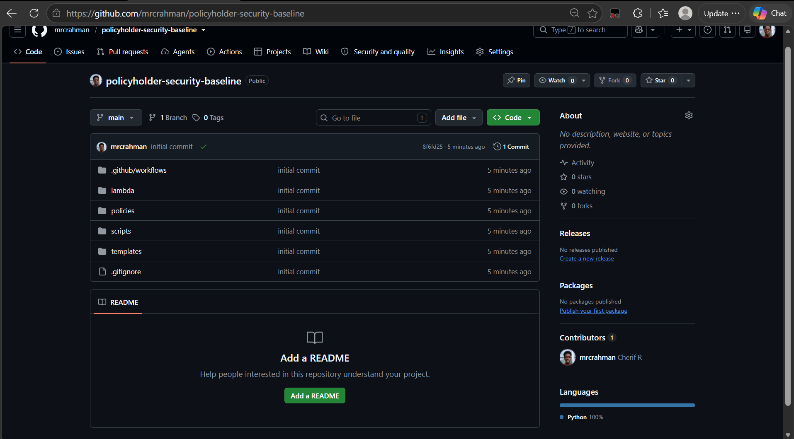
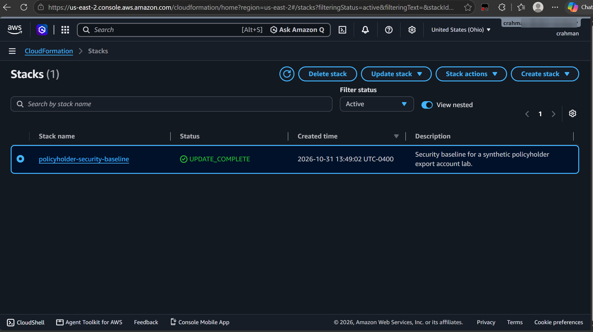
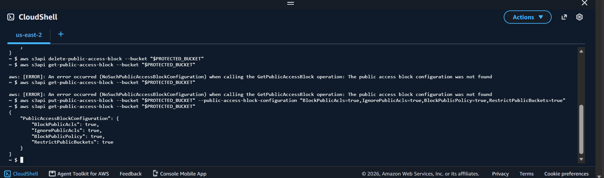
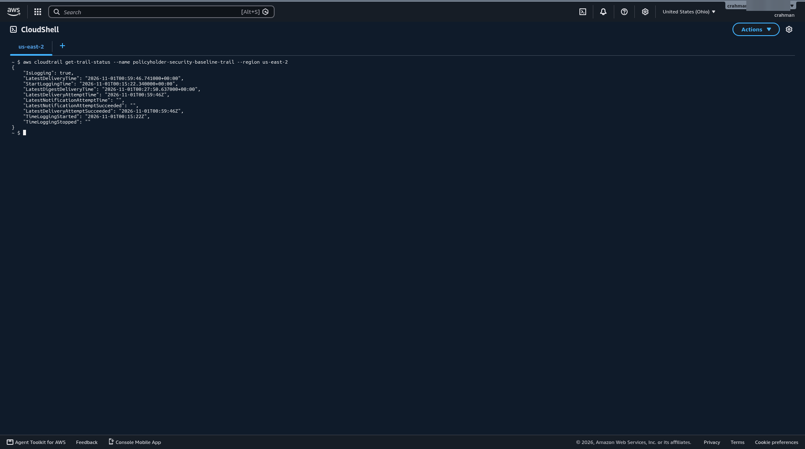
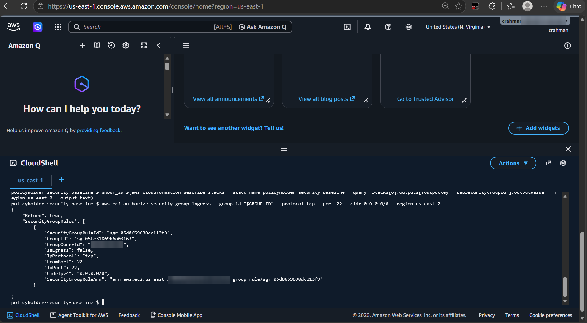

# Automate an AWS Security Baseline

**Author:** Cherif Rahman


## Defining a Safe, Automated Security Baseline

### Baseline detection, remediation, and SCP safety

In this project, I'm building an AWS security baseline. It's based on a scenario some companies have actually experienced: an employee accidentally removes part of the setup that keeps the organization safe, and an intruder gets in and does everything they can to cause damage. I'll focus on what they did.

## Building a CI-Gated Infrastructure Repository

### Establishing repeatable infrastructure security checks

First, I'm creating a Git repository that acts as a gate: if something in the security setup breaks or can't be trusted, the problem gets rejected before it's ever deployed. I'm adding the supplied infrastructure files, making sure they pass a local security check, and confirming that GitHub Actions works the way it should.



## Deploying Detective Security Controls

### Provisioning audit, compliance, and alerting services

With the repo in place, I'm deploying the security baseline itself. It's basically a set of guardrails I customized to watch what happens in the account and alert me if there's malicious activity. I did run into errors here: the region I was using had already been used, so the stack kept saying it couldn't be created or updated, and I had to switch to a different region.



## Demonstrating the S3 Guardrail Gap

### Testing an out-of-band S3 security change

Next, I'm using AWS CloudTrail and AWS Config to monitor my account for suspicious changes, with EventBridge and Lambda set up to catch them and turn the right settings back on, like Block Public Access. For this step, I'm grabbing the protected bucket from the stack output and showing the configuration gap without adding any data or a public bucket policy.

### What infrastructure drift revealed

When I removed the protected bucket's Block Public Access setting and checked whether it had worked, I saw how scary this is. It creates a gap, and if someone isn't careful, that gap can become a serious security risk.



## Automating S3 Block Public Access Recovery

### EventBridge-triggered Lambda remediation

To close that gap, I'm building a Lambda deployment package with the supplied handler, packaging the remediation template, and deploying it as a CloudFormation stack. Then I'm testing it by deleting the bucket-level setting to see whether the responder restores it automatically.

## Validating CloudTrail Protection and Tamper Detection

### Validating policy as code and alerting

Next, I'm validating the unattached CloudTrail protection SCP against its required actions, then triggering a brief CloudTrail stop-start event. After confirming the trail status, I'll check whether the tamper-alert email arrives.



### Safely keeping the SCP unattached

I kept the SCP unattached for two reasons: it avoids accidental lockouts, and standalone accounts don't support SCPs anyway. To make sure it's still safe, I ran our script to check its rules automatically.

## Extending Automated Remediation to World-Open SSH



### Precisely revoking only unsafe SSH access

In this extension, the responder runs a few checks before it changes anything. It makes sure the security group has the specified tag, so it knows the group belongs to the lab, and it checks whether the port is 22 and which IP ranges are allowed. Without those checks, it would blindly delete important rules, which would cause errors and give headaches to the people who set them up in the first place.

> **Note:** this repository doesn't include the SSH responder code. The deployed baseline detects world-open SSH with the AWS Config rule `policyholder-restricted-ssh` (`INCOMING_SSH_DISABLED`) on the lab security group.

## Reflecting on Security Automation Skills

### Tools and security concepts applied

The key tools I used were Lambda, CloudFormation, CloudTrail, CloudShell, Amazon EventBridge, Amazon SNS, and GitHub with Git. One thing I learned was how to figure out why the .yaml file I uploaded wasn't connecting with the AWS configuration I set up through Git. I also learned patience: it took me a while to understand why the stack wasn't connecting, how the configuration gap started, and what to do to prevent it.

### Project timeline and challenges

This project took me about 2 days. The most challenging part was connecting GitHub to CloudFormation, which took up a lot of my time. My current account had a problem for some reason, so I tried another way with a new account, and I'm glad I did.

### Next steps in cloud security

I did this project to learn how to connect GitHub to CloudFormation, use AWS Lambda to repair the gap, and use EventBridge to notify me when something happens in my account. Next, I want to go deeper into Infrastructure as Code.

## Deploy (us-east-2)

1. **Baseline stack:** create the stack `policyholder-security-baseline` in `us-east-2` with CloudFormation **Sync from Git**, pointing at this repo, branch `main`, and the deployment file `cfn-publish.json` (set `AlertEmail` to your address first). Or deploy it from the CLI:
   ```bash
   aws cloudformation deploy --region us-east-2 --stack-name policyholder-security-baseline \
     --template-file templates/baseline.yaml --parameter-overrides AlertEmail=you@example.com \
     --capabilities CAPABILITY_IAM
   ```
   Confirm the SNS subscription email.
2. **Remediation stack:** package the Lambda and deploy `templates/remediation.yaml` with the baseline stack's `ProtectedBucketName` and `AlertTopicArn` outputs (`ARTIFACT_BUCKET` is any S3 bucket you own in `us-east-2`):
   ```bash
   mkdir -p build/lambda && cp lambda/handler.py build/lambda/
   aws cloudformation package --region us-east-2 --template-file templates/remediation.yaml \
     --s3-bucket "$ARTIFACT_BUCKET" --output-template-file packaged-remediation.yaml
   aws cloudformation deploy --region us-east-2 --stack-name policyholder-remediation \
     --template-file packaged-remediation.yaml \
     --parameter-overrides ProtectedBucketName=<bucket> AlertTopicArn=<topic-arn> \
     --capabilities CAPABILITY_IAM CAPABILITY_AUTO_EXPAND
   ```
3. **SCP:** `policies/cloudtrail-protection-scp.json` is validated in CI by `scripts/validate_scp.py` and stays unattached. Attaching it requires AWS Organizations.

Every push and pull request runs the GitHub Actions gate in `.github/workflows/iac-security.yml` (cfn-lint, checkov, a Lambda compile check, and the SCP check).

## Clean up

1. Delete the remediation stack: `aws cloudformation delete-stack --region us-east-2 --stack-name policyholder-remediation`
2. Turn off Git sync for the baseline stack so a later push doesn't redeploy it.
3. Empty the protected bucket (`aws s3 rm s3://<ProtectedBucketName> --recursive`), then delete the baseline stack: `aws cloudformation delete-stack --region us-east-2 --stack-name policyholder-security-baseline`
4. The audit bucket uses `DeletionPolicy: Retain`, so delete it by hand when you no longer need the logs: `aws s3 rb s3://<AuditBucketName> --force`
