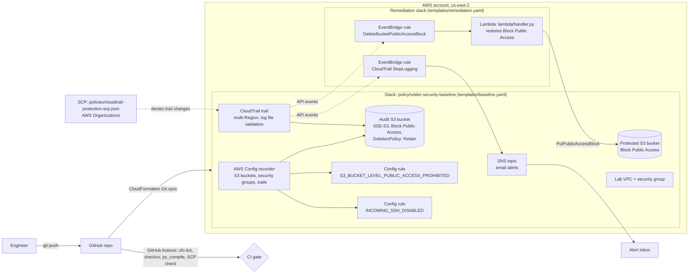
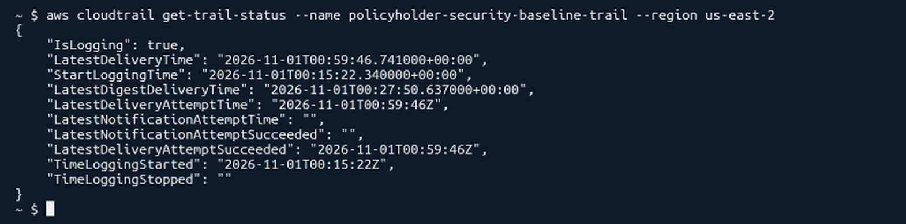

# Policyholder Security Baseline: Automated AWS Security Guardrails, Detection & Auto-Remediation

> **Practice scenario modeled on Nationwide. No affiliation.** This is a personal portfolio lab. It was not built for, with, or on behalf of Nationwide. Nationwide is used only as a realistic setting (an insurer that keeps policyholder data on AWS). Every account, bucket, and record here is synthetic.


**Region:** `us-east-2` (Ohio) · **Stack:** `policyholder-security-baseline` · **IaC:** AWS CloudFormation with Git sync · **CI:** GitHub Actions

## What this is

In the scenario, a new AWS account that will hold a policyholder document export fails its pre-launch security review. Nothing is logged, no one is told when risky changes happen, and every fix is manual.

This repo is the fix, written as code:

- **Detect:** a multi-Region CloudTrail with log file validation, plus an AWS Config recorder with two managed rules for public S3 buckets and world-open SSH.
- **Alert:** an SNS email topic. EventBridge sends to it when someone calls `StopLogging` on CloudTrail.
- **Auto-fix:** when someone deletes S3 Block Public Access on the protected bucket, EventBridge invokes a Python Lambda that puts it back, with no human involved.
- **Prevent:** a service control policy (SCP) that stops member accounts from changing or stopping CloudTrail, plus a CI gate that lints and scans every template before it can merge.

Every push to `main` is deployed by **CloudFormation Git sync**, so this repo is the source of truth for the live stack.

## Architecture



## What each piece detects or fixes

| Piece | File | Type | What it does |
|---|---|---|---|
| CloudTrail trail | `templates/baseline.yaml` | Detective | Multi-Region trail that records read and write management events, including global service events. Log file validation makes tampering with delivered logs detectable. |
| Audit bucket | `templates/baseline.yaml` | Protective | Stores CloudTrail and Config logs. SSE-S3 encryption, all four Block Public Access settings, ACLs disabled (BucketOwnerEnforced). The bucket policy only lets CloudTrail (scoped to this trail's ARN) and Config (scoped to this account) write. `DeletionPolicy: Retain` keeps the logs even if the stack is deleted. |
| AWS Config recorder | `templates/baseline.yaml` | Detective | Records S3 buckets, EC2 security groups, and CloudTrail trails, with a snapshot every 6 hours. |
| `policyholder-s3-public-access-prohibited` | `templates/baseline.yaml` | Detective | AWS managed rule `S3_BUCKET_LEVEL_PUBLIC_ACCESS_PROHIBITED`. Flags any bucket whose bucket-level Block Public Access is off. |
| `policyholder-restricted-ssh` | `templates/baseline.yaml` | Detective | AWS managed rule `INCOMING_SSH_DISABLED`. Flags any security group that allows SSH (port 22) from anywhere. |
| SNS alert topic | `templates/baseline.yaml` | Alerting | Email subscription set by the `AlertEmail` parameter in `cfn-publish.json`. |
| Protected bucket | `templates/baseline.yaml` | Protective | Stands in for the policyholder export bucket. Block Public Access is on. This is the bucket the auto-fix protects. |
| Lab VPC and security group | `templates/baseline.yaml` | Test target | Isolated VPC (`10.42.0.0/16`) and an empty security group used to test the SSH rule safely. |
| S3 auto-fix | `templates/remediation.yaml`, `lambda/handler.py` | Corrective | EventBridge matches the CloudTrail event `DeleteBucketPublicAccessBlock` on the protected bucket and invokes the Lambda. The Lambda turns all four Block Public Access settings back on. Its IAM role can only call `s3:PutBucketPublicAccessBlock` on that one bucket. |
| CloudTrail tamper alert | `templates/remediation.yaml` | Detective | EventBridge matches `StopLogging` and publishes to the SNS topic. The topic policy only accepts publishes from that one rule. |
| CloudTrail protection SCP | `policies/cloudtrail-protection-scp.json` | Preventive | Denies `CreateTrail`, `DeleteTrail`, `UpdateTrail`, `StartLogging`, `StopLogging`, `AddTags`, and `RemoveTags` for CloudTrail. Attach it to an OU or member account in AWS Organizations. SCPs never restrict the management account. |
| CI gate | `.github/workflows/iac-security.yml`, `scripts/validate_scp.py` | Preventive | Runs on every push and pull request with pinned tools: `cfn-lint`, focused `checkov` checks on the templates, a compile check of the Lambda, and a script that fails if the SCP drops a required CloudTrail action or stops covering `Resource: "*"`. |

## How it was built and tested

1. **Repo and CI gate.** Created the repo, templates, and GitHub Actions workflow so nothing reaches AWS without passing lint and scan checks.
2. **Deploy the detective baseline.** Connected the `policyholder-security-baseline` stack to this repo with CloudFormation Git sync (`cfn-publish.json` is the deployment file) and deployed CloudTrail, Config, the audit bucket, and SNS to `us-east-2`.
3. **Expose the missing S3 guardrail.** Removed Block Public Access from the protected bucket. Config flagged it as noncompliant, but nothing fixed it. Detection alone wasn't enough.
4. **S3 auto-fix.** Added the EventBridge rule and Lambda so that deleting Block Public Access is undone automatically.
5. **SCP and CloudTrail tamper alert.** Wrote and validated the SCP, then tested the `StopLogging` alert. Afterward, `get-trail-status` confirmed the trail was logging again:

   

6. **World-open SSH.** Opened SSH to `0.0.0.0/0` on the lab security group, confirmed `policyholder-restricted-ssh` flagged it, and removed the rule to get back to compliant.

## Deploy (us-east-2)

**Prerequisites:** an AWS account you own, the AWS CLI (AWS CloudShell in `us-east-2` works), and an email inbox for alerts. Only one AWS Config recorder can exist per Region, so use a Region where you don't already have one.

### 1. Baseline stack

**Option A: CloudFormation Git sync (how this repo runs).** In the CloudFormation console (`us-east-2`), create a stack named `policyholder-security-baseline`, choose **Sync from Git**, connect this repo and branch `main`, and point it at `cfn-publish.json`. Change the `AlertEmail` value there to your own address first. From then on, a push to `main` that changes the template or deployment file updates the stack.

**Option B: CLI.**

```bash
aws cloudformation deploy \
  --region us-east-2 \
  --stack-name policyholder-security-baseline \
  --template-file templates/baseline.yaml \
  --parameter-overrides AlertEmail=you@example.com \
  --capabilities CAPABILITY_IAM
```

Then confirm the SNS subscription from the email AWS sends you.

### 2. Remediation stack

`templates/remediation.yaml` uses the SAM transform and reads the Lambda code from `build/lambda`, so package it first. `ARTIFACT_BUCKET` is any S3 bucket you own in `us-east-2` for deployment artifacts.

```bash
REGION=us-east-2
BASE=policyholder-security-baseline
out() { aws cloudformation describe-stacks --region $REGION --stack-name $BASE \
  --query "Stacks[0].Outputs[?OutputKey=='$1'].OutputValue" --output text; }

mkdir -p build/lambda && cp lambda/handler.py build/lambda/

aws cloudformation package --region $REGION \
  --template-file templates/remediation.yaml \
  --s3-bucket "$ARTIFACT_BUCKET" \
  --output-template-file packaged-remediation.yaml

aws cloudformation deploy --region $REGION \
  --stack-name policyholder-remediation \
  --template-file packaged-remediation.yaml \
  --parameter-overrides ProtectedBucketName="$(out ProtectedBucketName)" AlertTopicArn="$(out AlertTopicArn)" \
  --capabilities CAPABILITY_IAM CAPABILITY_AUTO_EXPAND
```

(`policyholder-remediation` is an example stack name.)

### 3. SCP (optional, needs AWS Organizations)

```bash
aws organizations create-policy --name ProtectCloudTrail --type SERVICE_CONTROL_POLICY \
  --description "Deny CloudTrail changes in member accounts" \
  --content file://policies/cloudtrail-protection-scp.json
aws organizations attach-policy --policy-id <policy-id> --target-id <ou-or-member-account-id>
```

### Verify

```bash
# Trail is logging
aws cloudtrail get-trail-status --region us-east-2 --name policyholder-security-baseline-trail

# Config rule results
aws configservice describe-compliance-by-config-rule --region us-east-2 \
  --config-rule-names policyholder-s3-public-access-prohibited policyholder-restricted-ssh

# Auto-fix test: remove Block Public Access, wait about a minute, then check that it is back
aws s3api delete-public-access-block --bucket <ProtectedBucketName>
aws s3api get-public-access-block --bucket <ProtectedBucketName>
```

## Clean up

Delete in this order to avoid charges:

1. Detach and delete the SCP if you created it (`aws organizations detach-policy`, then `delete-policy`).
2. Delete the remediation stack:
   ```bash
   aws cloudformation delete-stack --region us-east-2 --stack-name policyholder-remediation
   aws cloudformation wait stack-delete-complete --region us-east-2 --stack-name policyholder-remediation
   ```
3. Turn off Git sync for the baseline stack in the CloudFormation console, so a later push doesn't redeploy it.
4. Empty the protected bucket, then delete the baseline stack:
   ```bash
   aws s3 rm s3://<ProtectedBucketName> --recursive
   aws cloudformation delete-stack --region us-east-2 --stack-name policyholder-security-baseline
   aws cloudformation wait stack-delete-complete --region us-east-2 --stack-name policyholder-security-baseline
   ```
5. The audit bucket has `DeletionPolicy: Retain`, so it survives stack deletion. Delete it by hand once you no longer need the logs:
   ```bash
   aws s3 rb s3://<AuditBucketName> --force
   ```
6. Delete the deployment artifact bucket if you made one for the remediation stack.

## Lessons learned

- **Check what your account plan can run before you design around it.** The first version enabled AWS Security Hub for a CIS benchmark score. On the AWS Free plan the deployment failed with `SubscriptionRequiredException`, so Security Hub was removed from the template (see the commit history). The Config rules still cover the two highest-risk checks.
- **Detection isn't remediation.** In step 3, Config correctly flagged the public bucket, and the bucket stayed exposed anyway. That gap is why the EventBridge and Lambda auto-fix exists.
- **Git sync makes `main` production.** Every merge that touches the template or deployment file redeploys the stack, so the CI gate matters more and template edits should be small and deliberate.
- **Least privilege applies to automation too.** The remediation Lambda can call one API on one bucket. The SNS topic accepts publishes from one EventBridge rule. Bucket policy statements are scoped with `aws:SourceArn` and `aws:SourceAccount`.
- **SCPs have limits.** They only affect member accounts in AWS Organizations, never the management account. Pair them with detection (the `StopLogging` alert) instead of relying on them alone.
- **Logs should outlive the stack.** `DeletionPolicy: Retain` on the audit bucket means deleting the infrastructure doesn't destroy the evidence. The trade-off is one manual cleanup step.

## Control mapping

These mappings come from AWS's published Security Hub CSPM control references ([CIS benchmark page](https://docs.aws.amazon.com/securityhub/latest/userguide/cis-aws-foundations-benchmark.html), [S3](https://docs.aws.amazon.com/securityhub/latest/userguide/s3-controls.html), [CloudTrail](https://docs.aws.amazon.com/securityhub/latest/userguide/cloudtrail-controls.html), [EC2](https://docs.aws.amazon.com/securityhub/latest/userguide/ec2-controls.html), and [Config](https://docs.aws.amazon.com/securityhub/latest/userguide/config-controls.html) controls), checked Oct 31, 2026. Security Hub itself isn't deployed here. The table shows which benchmark requirements this baseline's configuration addresses. NIST SP 800-53 Rev. 5 IDs are a subset of the IDs AWS lists for each control. Controls with no AWS-published mapping (the SCP, the tamper alert, the Lambda) are left unmapped on purpose.

| What this repo does | Related Security Hub control | CIS AWS Foundations | NIST SP 800-53 r5 (per AWS) |
|---|---|---|---|
| Multi-Region trail with read and write management events | CloudTrail.1 | v3.0.0 3.1 | AU-2, AU-3, AU-12, AC-2(4), CA-7, SI-4(20) |
| CloudTrail log file validation | CloudTrail.4 | v3.0.0 3.2 | AU-9, SI-4, SI-7(1), SI-7(3), SI-7(7) |
| Bucket-level Block Public Access, checked by `S3_BUCKET_LEVEL_PUBLIC_ACCESS_PROHIBITED` and restored by the Lambda | S3.8 | v3.0.0 2.1.4 | AC-3, AC-4, AC-6, AC-21, SC-7, SC-7(3), SC-7(4) |
| No SSH from anywhere, checked by `INCOMING_SSH_DISABLED` (restricted-ssh) | EC2.13 | v1.2.0 4.1 (in v3.0.0, requirement 5.2 covers this, but Security Hub checks it with a different rule, EC2.53) | AC-4, CM-7, SC-7, SC-7(4), SC-7(5) |
| AWS Config recorder enabled (**partial**: this recorder uses a custom IAM role and records 3 resource types, while Config.1 expects the service-linked role) | Config.1 | v3.0.0 3.3 | CM-3, CM-6(1), CM-8, CM-8(2) |

## Repository layout

```
.github/workflows/iac-security.yml   CI gate: cfn-lint, checkov, Lambda compile, SCP check
cfn-publish.json                     CloudFormation Git sync deployment file (template path + parameters)
templates/baseline.yaml              Deployed baseline: CloudTrail, audit bucket, Config + rules, SNS, lab VPC/SG
templates/remediation.yaml           EventBridge + Lambda S3 auto-fix, CloudTrail StopLogging alert
lambda/handler.py                    Restores S3 Block Public Access
policies/cloudtrail-protection-scp.json  SCP that denies CloudTrail changes
scripts/validate_scp.py              SCP check used in CI
docs/evidence/                       Screenshots
```

## Skills shown

AWS CloudFormation · CloudFormation Git sync · AWS CloudTrail · AWS Config · Amazon EventBridge · AWS Lambda (Python, boto3) · Amazon SNS · Amazon S3 security · AWS Organizations SCPs · IAM least privilege · GitHub Actions · cfn-lint · checkov · Infrastructure as Code · Security automation
